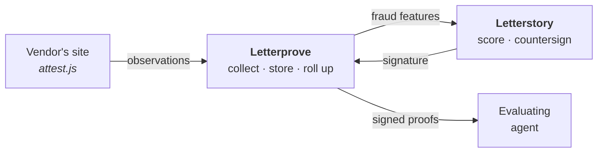
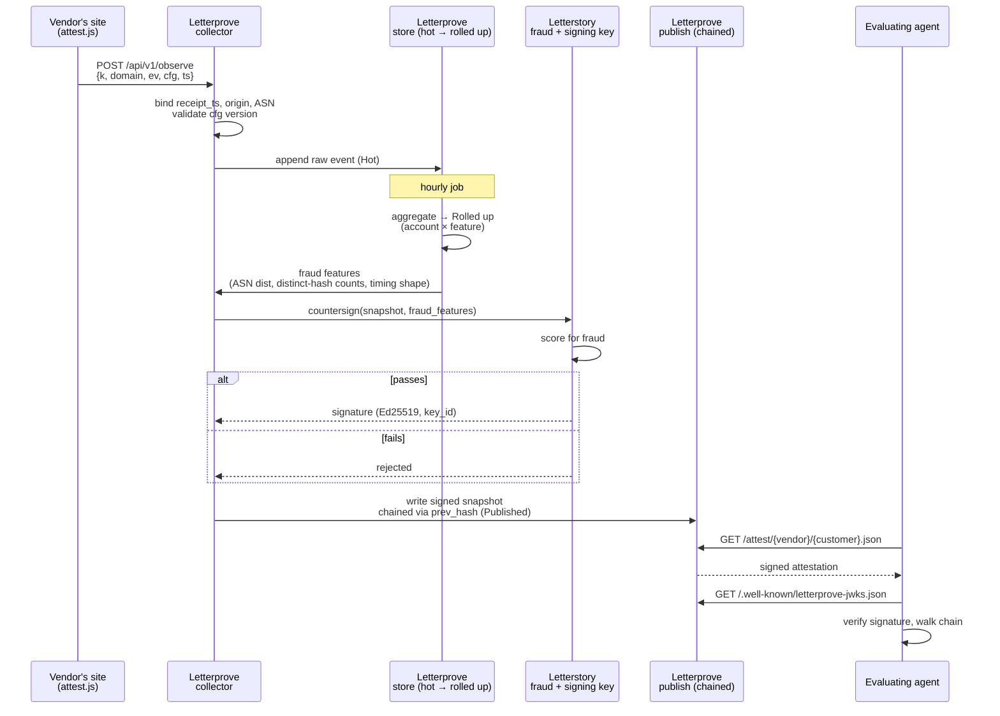

<div align="center">

<picture>
  <source media="(prefers-color-scheme: dark)" srcset="assets/logo-dark.svg">
  
</picture>

<br>

**Attested proof for AI agents.** &nbsp;·&nbsp; The "EEAT" for AEO.

</div>

---

## Current state (updated 2026-10-13)

- **What it attests.** One signed proof per vendor, about the vendor: its domain (proven by DNS, re-checked daily), its Stripe account (bound to that domain, or approved by Letterprove staff), and the companies observed signing in to its product. Customers are counted, never named, unless the vendor opts in to verified logo names from its own public logo wall.
- **Tiers issued today.** Tier 0 (nothing proven), tier 1 (sign-ins observed on the DNS-proven domain) and tier 3 (tier 1 plus settled invoices in the vendor's bound, live-mode Stripe account; live since 2026-10-12). Tier 2 is not issued: it needs the network (ASN) binding, which is not built. Tier 4 (customer counter-signature) was retired on 2026-10-12; old documents that carry it still verify.
- **Optional sections a vendor can show or hide.** Paying count (hidden, signed-in and paying, or all paying via Stripe), verified logo wall, PostHog history (labelled vendor-reported, never moves the tier), growth per month, retention, sessions, first observed. The domain, tier, companies observed and verify link are always shown; hidden sections are listed in `hidden_by_vendor`.
- **Signing.** Letterprove computes each snapshot; Letterstory scores it for fraud and signs it. A new snapshot is frozen every hour and hash-chained to the one before, and frozen rows cannot be rewritten.
- **This repository is public** (MIT). Every attestation's `method` field links to the exact commit that computed it.

**Live public proofs:** [Letter](https://app.letterprove.com/proofs/letterstory) (tier 3) and [Lettertrace](https://app.letterprove.com/proofs/lettertrace). The current list is in [/.well-known/letterprove.json](https://app.letterprove.com/.well-known/letterprove.json).

**How to verify a proof.** Open the snapshot's `verify` link, which shows the exact signed figures and whether the signature holds. Or check the signature yourself against the keys at [/.well-known/letterprove-jwks.json](https://app.letterprove.com/.well-known/letterprove-jwks.json) with [`scripts/verify.mjs`](scripts/verify.mjs), which shares no code with the service.

**Limits, stated plainly.**

- Letterprove and Letter (and its other products) share an owner, The Letter Company. Every affected proof says so.
- Sign-ins come from a script on the vendor's own site. A determined vendor can forge browser events with effort; tier 3 adds a third-party ledger, and tier 2 (network binding) is not built.
- Fraud scoring is early. Its thresholds were first tuned on Letter's own products and are being recalibrated as outside vendors join.

---

A human evaluating software might skim three tabs. An agent evaluates thirty
products, reads every claim, checks every source, and discounts for vendor bias.
Discovery gets a product on the shortlist. **Proof gets it picked.**

Letterprove turns a vendor's logo wall — a page of unverifiable claims — into
signed, machine-readable attestations that an agent can fetch, verify, and cite.

<!-- STATUS:AUTO:START — generated by scripts/gen-readme-status.mjs, do not hand-edit below -->
> **Build status** — regenerated from the code, not hand-maintained. Run `node scripts/gen-readme-status.mjs` after a change that should move a row; `npm test` fails if this block drifts from what the checks find.

| | |
|---|---|
| ✅ Signing, chaining, proof endpoints, verifier | scripts/verify.mjs independently re-verifies signatures against fixture and live data |
| ✅ Collection (script → collector → rollups) | src/app/api/v1/observe/route.ts records real events into hot_rollups |
| ✅ Collection refuses unverified vendors | observe/route.ts checks vendor.domainVerified before recording anything |
| ✅ Every vendor row is created with a domain-verification token | domain_verification_token has a DB default, so create_vendor gets one without asking — the self-serve signup form this once described was retired with the local dashboard |
| ⬜ Fraud features (ASN distribution, hash counts) | fraud-features.ts still hardcodes these null — accepted gap, not wired to real ASN data yet |
| ✅ Tier 3 — Stripe corroboration | lib/stripe/sync.ts joins settled invoices to observed domains and writes vendor_payment_evidence; a subscription with no invoice that actually settled is not evidence, and a TEST-mode key stores nothing |
| ✅ Publication is opt-in — a vendor is private until someone publishes it | findPublishedVendor() is the gated resolver every public route goes through; collection, freeze and signing still run while private, so publishing is a flip rather than a rebuild |
| ✅ Support / help infrastructure | the submit_support_request tool posts through lib/support/slack.ts to a Slack incoming webhook |
<!-- STATUS:AUTO:END -->

Every decision is tagged **Decided**, **Proposed**, or **Open**.

---

## The problem

Every logo on a vendor's marketing site is an unverified claim. So is every
testimonial, every case-study PDF, and every "trusted by 500 teams." A human
discounts them automatically. An agent does too — and unlike the human, it will
go looking for something better.

There is currently no way for a vendor to say *"Acme is a real customer, active
since 2023, running SSO and the API, 4,182 sessions last month"* in a form an
evaluating agent can check rather than take on faith.

## What Letterprove does

| | | |
|---|---|---|
| **01** | **Install** | One script tag on the vendor's site. No SDK, no backend, no data warehouse. It begins observing real product usage the moment it loads. |
| **02** | **Verify** | Letterprove confirms the vendor is who it says it is — its domain by DNS, its Stripe account bound to that domain — and observes real usage directly, with facts the vendor cannot forge. |
| **03** | **Attest** | One signed, hourly proof of the vendor: companies using it, sessions, and how many of those companies pay through its Stripe. Counts, never names. Agents fetch, verify and quote it. |

```html
<script src="https://app.letterprove.com/attest.js" data-key="lp_live_9f2c…"></script>
```

---

## The trust model

This is the part that decides whether the product is real, so it goes first.

The script runs on **the vendor's own site**. Everything it reports originates,
at root, from the party who benefits from it looking good. A Letterprove
signature proves *we observed this*. It does not, by itself, prove *this is
true*. Those are different claims and the JSON must never blur them.

We treat that as a feature. What we publish is **one attestation per vendor**
([decision 30](#decision-log)): who the vendor is (its DNS-proven domain, its
Stripe account bound to that domain) and what backs it (companies observed
signing in, how many of them pay, sessions), in counts. No customer is ever
named or contacted. The attestation carries a **provenance tier**, so an agent
can weigh it instead of trusting it:

| Tier | Source | Forgeable by the vendor? |
|:---:|---|---|
| **0** | Vendor-asserted — the ordinary logo wall | Trivially |
| **1** | Observed by our script, on a domain the vendor proved by DNS | With effort |
| ~~**2**~~ | ~~Bound to network facts the vendor doesn't choose (ASN)~~ — **not issued** until the ASN binding is built; documents signed before 10-13 may carry it, read them as tier 1 | — |
| **3** | Tier 1, plus at least one observed company paying a settled invoice in the vendor's own (bound) live Stripe. The highest tier; how many pay is private to the vendor | Only by paying themselves real money |

Tier 4 (a customer counter-signature) was retired on 10-12. Old documents may still carry it and still verify; read them as tier 3.

**The tier comes from evidence alone** ([decision 29](#decision-log)). Nobody
sets it, the vendor included: no DNS proof or nothing observed is tier 0,
companies observed signing in on the DNS-proven domain is tier 1, and at least
one of those companies paying through the vendor's own Stripe is tier 3 — the
strongest evidence class present, always published beside the counts
([decision 30](#decision-log)). Domain proof is re-checked daily, so a lapsed
or removed record stops counting.

**Tier 2 is reserved, not issued.** The vendor can fabricate a payload, but not
our server's receipt timestamp, not the observed origin, and not the ASN a
request arrived from. Binding all three raises the cost of faking a month of
usage from *editing a JSON file* to *running a distributed spoofing rig*. The
first two are captured; the ASN is not (`asn_distribution` is still null), so
tier 2 waits for it. Until 10-13 the aggregate claimed tier 2 on the first two
facts alone while the same evidence published as tier 1 per customer; one
evidence class now earns one tier.

**Tier 3 is where `"verified": true` stops resting on the vendor's own word**,
because it is read from a third party's ledger: an invoice that actually
settled in the vendor's live-mode Stripe account, for real money, recently.
Note the honest limit — corroboration is not immunity. A vendor willing to pay
themselves through their own Stripe account can still reach tier 3. The
account is bound to the vendor by the domain it publishes about itself (or a
staff approval, signed as `stripe_binding: staff_override`). What changed is the price: from free to
a real charge through a real processor, in an account Stripe has verified,
leaving a record in the vendor's own books. Tier 3 is the top of the ladder:
Letterprove attests from the vendor's DNS proof and the vendor's own Stripe
ledger, and does not contact the vendor's customers (see
[Customer counter-signing — Retired](#customer-counter-signing--retired-10-12)).

Rigor compounds. Ship tier 1, then 3, then the ASN binding for 2, and never
print the word *verified* where the tier doesn't earn it.

---

## Architecture

Letterprove is **its own service, its own repo, its own deploy**. It owns
everything specific to attestation. Letterstory is a deliberately thin trunk
holding only what is genuinely cross-service.

The organizing rule: **service-level concerns live in the service; the trunk
coordinates.** Letterstory already carries a lot, and every Letterprove concern
pushed into it is coordination overhead that compounds as both grow. Leaves stay
fat and autonomous, the trunk stays minimal and agile.



| Trunk — **Letterstory** | Leaf — **Letterprove** |
|---|---|
| Anti-fraud scoring **+ the signing key** | Vendors and the companies observed for them (private, counts only on proofs) |
| Cross-product customer record | Billing and entitlements — isolated in LP for now, explicitly punted |
| Human identity — who a user is, and which org they act for | Signal registry, per-vendor collection config |
| The vendor-facing UI (the Proofs tab) | The script, collector, storage, rollups |
| | Publishing, endpoints, proof surfaces |

**Narrowed 08-11** — two things left in the trunk, both genuinely cross-service.
Auth and billing moved to the leaf; neither survived the test above once pressure-tested
against how `time.letterbrace.com` and `kernels` actually run (fully independent
auth, no federation — the only existing cross-service trust anywhere in the
fleet is a machine-to-machine shared secret, never a human-identity bridge).

**Reversed 08-28 ([#124](https://github.com/letterstory/Letterprove/pull/124)),
completed 09-01 ([#130](https://github.com/letterstory/Letterprove/pull/130))** — the auth half of that
narrowing did not survive contact with a second product. Letterprove's own
login existed so a vendor could reach a Letterprove dashboard, and once the
vendor surface moved into Letterstory's Proofs tab there was nobody left to
log in: the leaf was maintaining a user pool, a signup flow, an OAuth server
and a membership table to serve zero browsers. Identity moved to the trunk.
Billing stayed in the leaf, untouched, and the `kernels` precedent still holds
for everything it was cited for — the countersign RPC is still a
machine-to-machine shared secret, and no human identity crosses it.

The row above therefore reads the other way now, and [the test that keeps this
honest](#the-test-that-keeps-this-honest) is the thing to watch: Letterprove
can still ship a signal, a rollup or an endpoint without Letterstory moving,
but a **new tool** is a coordinated change, because the caller lives over
there.

### Identity — **Decided (revised 08-28)**

**Letterprove has no login.** Letterstory is the identity authority, and the
line that decides everything else here is the one between *a person* and *a
subject of a claim*:

- **Letterstory owns every human.** Users, orgs, membership and role live in
  `organization_users` and are never mirrored here. Letterprove holds one
  pointer — `vendors.letterstory_org_id`, 1:1 and `NOT NULL` — and nothing
  else about a person.
- **Letterprove owns every subject.** Vendors, the companies observed for
  them, publishable keys. Acme is the vendor's customer, not
  ours; they will never hold a Letterstory account, and modelling them in the
  trunk would be genuinely wrong. That is the half of the original argument
  that was right, and it is untouched.

The earlier reading — that staff auth belonged here too — did not survive the
vendor surface moving to Letterstory. Staff is now a **named allowlist**, not
a user pool: `STAFF_USER_IDS` holds Letterstory user ids, and
`src/lib/staff/allowlist.ts` fails closed, so a deployment that has not named
its staff serves no cross-vendor surface at all. That the check lives here and
not there is deliberate — Letterprove's most sensitive surface stays revocable
from Letterprove, without someone else shipping.

#### How a vendor reaches it

There is no browser session to reach, so every vendor operation arrives as one
call from Letterstory's backend:

```
POST /api/v1/tools/{name}     authenticated by the LETTERSTORY_API_SECRET seam
{ "org_id": "…", "user_id": "…", …args }
```

`src/lib/tools/registry.ts` holds **21 tools**, each a `defineTool` with a zod
input and output contract the dispatcher checks (see [Tool
contracts](#tool-contracts--decided-09-08)). The seam resolves `org_id` to a
vendor and scopes every handler to it, so a caller cannot name another
vendor's data. It grants `vendor:read`/`vendor:write` for any org; it grants
`staff:read`/`staff:write` only when the acting `user_id` is on Letterprove's
own allowlist.

Two things this deliberately does **not** do. It does not believe a
`staff: true` flag from the other side — that would make every cross-vendor read
contingent on Letterstory never having a bug in its own internal-user check.
And it is not a defence against a compromised Letterstory: whoever holds the
shared secret can name any user id they like. It defends against the realistic
failure, which is a mistake on the far side of the seam.

The public collection and proof surfaces — `/api/v1/observe`, `/api/v1/config`,
`/attest/*`, `/proofs/*`, `/.well-known/*` — are unauthenticated by design and
were never touched by any of this.

#### Tool contracts — **Decided (09-08)**

Every tool declares a zod `input` and `output` schema in
`src/lib/tools/schemas.ts`, and `dispatchTool` validates each success against
the tool's own `outputSchema` everywhere except production.

The reason that is enforcement rather than documentation: nothing serves these
schemas. `GET /api/v1/tools` was retired with the CLI, so there is no
discovery surface to publish to. A published schema that drifts is a lie told
confidently; a schema the dispatcher checks cannot drift without a test going
red. `defineTool` makes a missing schema a compile error, and
`schemas.test.ts` rejects a contract that says nothing — a bare `z.unknown()`
satisfies the compiler and describes nothing.

**Production is deliberately exempt from the output check.** A wrong contract
is a documentation problem, and turning a working vendor call into a 500 to
announce it is strictly worse than serving the payload and fixing the schema.
Failures surface in CI, where they cost nothing.

### Open code, closed data — **Decided**

Letterprove's computation is **open source**, and that is a product decision
rather than housekeeping. The premise of the whole system is *don't take our
word for it* — an agent that can read the code that produced a claim is in a
categorically better position than one that can only check a signature.

So every attestation carries a `method` pointer: repo, path, and commit SHA of
the rollup logic that computed it. **The attestation cites the code that made
it.** The link itself is already real —
[`methodUrl()`](src/lib/attest/method.ts) builds it from the deployed commit
SHA today.

The inverse holds just as firmly. Open source is not open data — the
observations Letterprove stores are never public. And **anti-fraud stays
closed**, in Letterstory, because published detection logic is an evasion
manual.

**What "open source" requires.** Every `method` link an attestation ships
points at this repo, which is public, so an outside agent can follow that link
and read the exact code. Three things made that claim true:

- ✅ **A real license** — MIT, in [LICENSE](LICENSE). Reading the code isn't
  the whole claim; a skeptical agent or a competitor being able to actually
  clone and run it is.
- ✅ **Nothing sensitive in the history.** Verified across all commits: no
  credential has ever been committed, and `.env*` has been ignored since the
  first one. Anti-fraud lives in Letterstory, so the closed half was never
  here to leak. `scripts/set-cron-secret.sh` generates its secret at runtime
  and hardcodes none.
- ✅ **The repo is public.** Every `method` link in every attestation resolves.

And one rule that holds now that it is public:

> **`main` never gets force-pushed or rebased once public.** Every published
> attestation pins a commit SHA that has to stay resolvable indefinitely, or
> the trust chain breaks retroactively for every attestation published before
> the rewrite — silently, since nothing about an already-signed attestation
> would flag it.

### The signing seam

One capability does not move to the leaf: **the authority to say "this is
true."**

```
Letterprove computes a snapshot
  → Letterstory scores it for fraud and countersigns
    → Letterprove publishes
```

This is what makes the fraud check load-bearing instead of advisory. If
Letterprove held the key, Letterstory's scoring would be a report nobody is
obliged to obey, and a single compromise would mint arbitrary valid proofs.
The leaf is autonomous for everything except the one irreversible act.

### The test that keeps this honest

Two services that must deploy together are not two services. The check:

> **Letterprove can ship a new signal, a new rollup, or a new endpoint without
> Letterstory moving.**

Countersigning is a runtime call, not a build dependency, so this holds. If a
change ever requires a coordinated deploy, the boundary has drifted and the
fix belongs here, not in a release plan.

---

## Event lifecycle

The diagram above draws the shape. This traces one event through it, hop by
hop — the spine the sections below hang their detail off of.



### Emission

Browser fires `POST /api/v1/observe` per the [event schema](#event-schema--decided).
Domain only, sendBeacon-safe, key-scoped. Nothing is trusted from the client
except that it happened — counting and validation both run server-side.

### Processing — Letterprove side

1. **Ingest.** The collector binds facts the client did not supply — receipt
   timestamp, request origin, ASN — and validates the event's `cfg` version
   against what's on file. Stored as a Hot-tier row.
2. **Roll up.** An hourly job aggregates Hot → Rolled-up, per account ×
   feature. This is what the charts and the eventual attestation numbers read.
3. **Extract fraud features.** Letterprove computes a *feature stream* from
   the rollups — ASN distribution, distinct-hash counts, timing shape — never
   raw observations. This is the only thing that crosses to Letterstory; see
   [Published vs. retained](#published-vs-retained) — all raw data stays put.

### Processing — the one trunk crossing

4. **Countersign RPC.** Letterprove calls Letterstory with the proposed
   snapshot and fraud features. Letterstory scores it and, if it passes,
   signs with the Ed25519 key that never leaves its environment — see
   [the signing seam](#the-signing-seam). This is the single call where the
   two services must agree at runtime; everything else in this trace is
   Letterprove alone.

   > [!NOTE]
   > **Decided (08-11):** a scoped shared secret, same shape as the
   > `KERNEL_HEADLESS_KEY` pattern between `lb` and `kernels` — Letterprove
   > sends it, Letterstory checks it before running fraud scoring. No mTLS,
   > no service-identity PKI; that's infra this pair of services doesn't need
   > yet. One deliberate addition over the `kernels` precedent: this secret
   > gates entry to the signing endpoint, not just job submission, so it's
   > **independently rotatable** from day one — same additive rollover the
   > Ed25519 signing keys already use (mint new, both valid during rollover,
   > no coordinated redeploy). Fraud scoring stays the real gate against a
   > leaked secret; the rotation habit is what keeps a leak cheap to close.

### Publication

5. **Publish.** Letterprove writes the now-signed snapshot to the Published
   tier, chained to its predecessor via `prev_hash`. This is what makes the
   record auditable, not just signed.

### Presentation

6. **Agent fetches.** An evaluating agent — or a same-origin proxy on the
   vendor's domain — requests `/attest/{vendor}/{customer}.json` or
   `/proofs/{vendor}`, the latter of which carries JSON-LD pointing back at the
   signed documents.
7. **Agent verifies.** It pulls the public key from
   `/.well-known/letterprove-jwks.json` by `key_id`, checks the signature,
   and — if it wants the audit trail — walks `prev_hash` back through
   `/attest/{vendor}/{customer}/chain`. Nothing past this point asks to be
   trusted; it's checked. (Confirmed empirically, not just in theory — see
   the [AEO experiment run log](experiments/aeo/README.md#run-log): agents
   verified signatures unaided, and unprompted ran tamper and self-mint
   tests against them.)

---

## Collection

### The one hard rule: domain only

> [!IMPORTANT]
> The script sends the **domain part of an account identity and nothing else**.
> `acme.com`, never `john@acme.com`.

The domain does the entire job of attributing activity to a customer. The local
part does no additional work and carries every downside: end-user PII from
someone else's product, a DPA with every vendor, GDPR surface, and a breach
story. It never leaves the browser.

The same discipline applies throughout — no user ids, no cookies, no IP in the
payload, no raw referrer. A visit is a row of facts, not a person. This is a
constraint, not an oversight, and it is what keeps collection outside consent
territory on the end-user side.

### Identity resolution — **Decided**

Account identity is **inferred from the email domain**. Inference *proposes*;
**the alias map decides.**

> [!NOTE]
> **Revised (08-13):** "no vendor integration work" originally meant no
> *backend* integration — no server-side identity call, no webhook, no data
> export. It never meant zero client-side wiring: nothing on a page hands a
> script a user's email without being asked. The one line of integration that
> remains is the vendor's app calling `Letterprove.identify(email)` once it
> has rendered who's logged in — see [Client API](#client-api--decided).

Letterprove holds a domain→account alias list per customer, because inference
alone is wrong in three predictable ways, and a wrong answer here is not a
missing row — it is a signed attestation that is false:

- **Free-mail addresses** (`gmail.com`, `outlook.com`) map to no company. They
  need an explicit list and an *unattributable* bucket, or those sessions
  silently vanish from the counts.
- **One company, many domains** — `acme.com`, `acme.co.uk`, `acmecorp.com`, plus
  acquisitions. Naive inference splits one customer into five, each too small to
  attest. (Lettertrace solved this shape already: `brand_domains text[]`,
  index 0 = primary.)
- **Contractors and agencies** — `someone@consultancy.com` working inside Acme's
  tenant is attributed to Consultancy. This is the case that publishes something
  false, and the only defense is a human-correctable mapping.

Because the mapping is service-local data, fixing any of these is a row edit —
never a vendor redeploy, and never a cross-repo coordination.

### Event schema — **Decided**

Three events, not a general analytics firehose. The firehose is what turns this
into a six-month schema debate.

```jsonc
POST /api/v1/observe      // sendBeacon-safe, key-scoped, origin-pinned
{
  "k":      "lp_live_…",  // publishable key — identifies vendor, validates origin
  "domain": "acme.com",   // the join key — domain only, always
  "ev":     "session",    // session | signup | login — phase-1 only, see below
  "cfg":    7,            // config version that produced this event
  "ts":     1754870400    // client-observed time — ordering/dedup only, never authoritative
}
```

`ev` is a closed enum scoped to the phase-1 signal list — `session | signup |
login` — confirmed 08-11: signups, logins, sessions, active accounts. Nothing
else this phase. It does **not** include a `feature`/named-event type: shipping
one now would silently pre-empt that confirmed scope. Named events ride on the
config endpoint's `signals` registry once that's real, as a phase-2 addition —
not wired speculatively today. "Active accounts" isn't a fourth event type
either; it's derived server-side from session/login activity, so it needs no
wire representation.

The client sends facts. **All counting happens server-side** — never trust a
counter the page could inflate. `ts` is one of those facts, not a source of
truth: it's client-observed and untrusted, used only for client-side ordering
and dedup. What the rollup actually keys off is `receipt_ts` — the server-bound
timestamp below.

Each observation is stored bound to facts the client did not supply: our receipt
timestamp (`receipt_ts`), the request origin, and the originating ASN. ASN
matters more than geography for fraud detection — *"all 4,182 sessions came
from one AWS range"* is the tell that catches a spoofing rig, and country-level
geo never would.

The response is always `204`, even on a bad key or stale `cfg` — per
[Reliability](#reliability) below, the host page never sees a failure. Status
lives entirely in the `x-letterprove` header, never the body.

One transport gotcha worth deciding now instead of discovering in production:
`navigator.sendBeacon` can't reliably set `Content-Type: application/json` — it
often lands as `text/plain`. The collector parses the body as JSON regardless
of what `Content-Type` says, or `attest.js` intermittently fails in a way that
looks like a client bug and isn't.

For tier 2 server-side reporting, a parallel `POST /v1/ingest` from the vendor's
backend, HMAC-signed with a replay nonce. Its field shape is explicitly out of
scope here — phase 1 is script-only, so specifying it now would be designing
for a phase we're not building.

### Configuration — **Decided**

The script pulls its collection config from Letterprove at boot. Signals change
without shipping new script and without a vendor ever re-pulling.

```jsonc
GET /api/v1/config?k=lp_live_…
→ 200, Cache-Control: max-age=…, stale-while-revalidate
{
  "cfg":     7,
  "signals": [],  // reserved for phase-2 named/feature events; empty in phase 1
  "visitors": { "pixel": { "customer_id": "…", "profile_id": "…" } }
                  // only when the vendor turned on visitor identification
}
```

Keyed by the same publishable `k` as events — `attest.js` has nothing else to
work with beyond its `data-key` attribute. CORS open
(`access-control-allow-origin: *`), same as the proofs endpoint, since it's
fetched cross-origin from the vendor's page.

- **Fails closed.** No config, no collection. Never blocks page render. The
  edge case the constraint alone doesn't cover: a cold cache *and* a failed
  fetch (first-ever page load, service down) means no collection, not a guess
  — only a warm cache lets a blip degrade gracefully.
- **Cached last-known** via real `Cache-Control`/`stale-while-revalidate`, not
  a custom TTL field — the browser already does this for free.
- **Public by nature.** It ships to a browser; anyone can read what a vendor
  collects. No secrets in it, ever.
- **Versioned.** Every event carries its `cfg` version, or a mid-month schema
  change makes the rollup uninterpretable after the fact. `signals` ships now,
  empty, purely so phase-2 doesn't force a breaking response-shape change
  later — the one piece of forward design here that's free.

### Client API — **Decided**

`attest.js` (`public/attest.js`, no dependencies, no build step) has exactly
three calls, and never anything to configure beyond `data-key`:

```js
Letterprove.identify(email)  // establishes domain, fires one "session" per page load
Letterprove.signup(email)    // identifies, then fires "signup"
Letterprove.login(email)     // identifies, then fires "login"
```

`email` never crosses the wire — the script splits off the domain locally and
discards the rest before any request is built; see [the one hard
rule](#the-one-hard-rule-domain-only). `identify` alone is what a vendor calls
on every authenticated page load; `signup`/`login` call it internally, so a
vendor wiring up an auth success handler never has to call both.

Calls made before the config fetch resolves are queued in memory and flushed
once it does; a failed or absent config permanently drops the queue for that
page load rather than guessing — the same fail-closed rule as
[Configuration](#configuration--decided). Every public method is wrapped so
nothing here can throw into the host page, and transport prefers
`navigator.sendBeacon`, falling back to a `keepalive` `fetch` where it's
unavailable.

### Agent visits — **Decided (10-13)**

A second, separate question the same install answers: **which AI agents and
crawlers read the vendor's own site.** It is private analytics for the vendor
and never evidence — nothing in `vendor_agent_visits` is read by the
attestation, the tiers, or any public route. Code: `src/lib/agents/visits.ts`,
`POST /api/v1/agent-visit`, tool `get_agent_visits`.

Two ways in, because most agents never run JavaScript:

| Mode | Who sends it | What it sees |
|---|---|---|
| **client** | `attest.js`, automatically, on any page where `navigator.webdriver` is set or the user-agent names an agent. Sends only `{k, path, client: true, webdriver}`; the server reads the user-agent, address and `Signature-Agent` from the request's own headers and the host from `Origin`. | Agents that render pages in a real browser (ChatGPT's agent, Comet, headless browsers). |
| **server** | An optional few lines in the vendor's server (`get_install_snippet` → `server_snippet`: a Next.js middleware and a generic Node version), forwarding `{k, ua, ip, path, host, signature_agent}` fire-and-forget with `keepalive`. | Everything that fetches HTML and leaves: ChatGPT/Claude/Perplexity fetchers, GPTBot, ClaudeBot, Googlebot, Bingbot. |

Rules: browsers and unrecognisable clients are dropped before any database
read; the host must be the vendor's verified domain or an accepted host
(`vendor_hosts`); an unverified vendor collects nothing — the same door as
`/v1/observe`. Each visit is folded into one row per vendor, day, agent, kind,
verified flag and path by `record_agent_visit()`. Paths lose their query
string and fragment and id-like segments become `:id`. **No address and no raw
user-agent are stored.**

`verified` means the request came from an address the claimed operator
publishes for its agents (`src/lib/access/verify-agent.ts`, the same check
agentic-read billing uses, with Google's and Bing's crawler lists added). In
server mode that address is the one the vendor's server reported, so it is
only as honest as that server; and the publishable key is not a secret, so
anyone can post here. Both are acceptable for analytics a vendor reads about
itself, and both are why none of it is ever evidence. ChatGPT's agent browses
under an ordinary Chrome user-agent and is recognised by `Signature-Agent:
"https://chatgpt.com"` (stored as claimed; the signature itself is not
checked).

### Reliability

Telemetry must never break a host page — every path wrapped, every failure
silent. And because collection spans a third party's page, a CDN, and our
collector, **the script's response carries a diagnostic header**
(`x-letterprove: on | off`) from day one. Whether a vendor is reporting should
be answerable with one `curl`, not an afternoon. Configuration bugs across a
distributed install look exactly like broken code; this is what makes them
visible.

### Visitor identification — **Decided (10-13)**

A vendor can have the people visiting its own site identified, through the
same `attest.js` tag. It is vendor-private analytics, a different data class
from everything above, and it is kept apart from the evidence on purpose:

- **Opt-in, per vendor.** `set_visitor_identification { enabled }`. It needs a
  DNS-verified domain. Turning it on registers the verified domain and each
  accepted host as a Maverick Intelligence Tracked Domain under our partner
  account (`clientRef = letterprove:{vendor id}`) and records the account's
  pixel ids. From then on `/v1/config` carries
  `visitors: { pixel: { customer_id, profile_id } }`, and `attest.js` loads the
  Maverick pixel exactly as Letter's own sites do. Off, the config has no
  `visitors` field and the script is unchanged.
- **Nothing stored.** `get_visitors { limit, days }` pulls people from
  Maverick live (cached five minutes, since the account's 1,000 requests an
  hour are shared with Letterstory) and returns them with a per-company
  rollup. Letterprove writes none of it to its database.
- **Never evidence, never public.** A company visiting a site is not a
  customer. Nothing here is signed, counted in an attestation, or shown on a
  proof page.
- **Tenant isolation.** The partner account sees every tracked site's people.
  A record reaches a vendor only when it was seen on that vendor's verified
  domain or an accepted host, or carries that vendor's `clientRef`, and only
  while the domain is still verified (`attributeVisitors` in
  `src/lib/vendors/visitors.ts`).
- **Turning it off** deactivates only the domains this feature registered. A
  domain the partner account already tracked (one of our own sites) is never
  deactivated by a vendor.

Env: `MAVERICK_API_KEY` (data reads), `MAVERICK_PARTNER_API_KEY` (Tracked
Domain registration), optional `MAVERICK_PIXEL_PROFILE_ID` when Maverick's
registration answer carries no profile id. Without the partner key the toggle
is stored and reported `pending_registration`.

---

## Publication

### A vendor is private until someone publishes them — **Decided (09-14)**

Nothing about a vendor is public until `vendors.proofs_published_at` is set.
While it is null, `/proofs/{vendor}`, `/attest/{vendor}`, and both chain routes
answer **404** — the same 404 an unknown vendor gets — and the vendor is absent
from the home page and from `/.well-known/letterprove.json`.

What is gated is **publication and only publication**:

| | Private | Published |
|---|---|---|
| Collecting events | ✅ | ✅ |
| Hourly rollups | ✅ | ✅ |
| Frozen to `published_snapshots` / `published_aggregates` | ✅ | ✅ |
| Signed and counter-signed | ✅ | ✅ |
| Readable by the vendor (`get_proof_summary`, `list_snapshots`) | ✅ | ✅ |
| Every public route | **404** | ✅ |
| Listed in discovery | ✗ | ✅ |

History is built the whole time, it just doesn't leave the building. So
publishing needs no backfill and no re-signing — a vendor who has been
collecting for a month goes public with a chain that already reaches back to
their first observation, rather than starting one on launch day.

**Why this exists.** Until 09-14 a vendor was published the moment its row
existed. Creating `letterstory` as a second vendor — for fraud calibration, and
to dogfood our own install — immediately served a signed aggregate of zeros at
`/attest/letterstory`, and installing the collector would have turned those
zeros into a public, signed count of how many companies use Letterstory, before
Letterprove had launched. Every real vendor will want to install, watch it work
for a few weeks, and go public deliberately. Publishing a customer count from
minute one is the wrong default for a product whose entire subject is trust.

**404, not a "this vendor is private" page.** An unpublished vendor has to be
indistinguishable from one that does not exist, or guessing slugs confirms
which companies have installed Letterprove and not launched yet — a fact about
someone else's roadmap.

**How it is enforced.** `findPublishedVendor()` in `src/lib/fixtures/vendors.ts`
is the gated resolver, sitting beside the ungated `findVendor()` every internal
caller keeps using; `publishedVendorProof`, `publishedVendorAggregate`,
`publishedVendorAggregateChain` and `publishedVendorSlugs` are the gated doors
in front of the composition functions of the same name. The two-function shape
is deliberate: a gate once lived inside one function's body and only
the route that happened to call it was protected ([#137](https://github.com/letterstory/Letterprove/pull/137)),
so the gated door has a different name and the call site says which one it
opened.

**Flipping it.** `publish_proofs` and `unpublish_proofs` on the tool dispatcher,
both `vendor:write` and both argument-less — the vendor is resolved from the
caller's principal. Staff reach them the same way a vendor does, by acting for
that vendor's Letterstory org, so there is no staff-scoped duplicate taking a
slug. `publish_proofs` refuses a vendor whose domain is unverified, because the
collector records nothing for one and the only document it could publish is a
signed zero. Unpublishing stops serving; it cannot un-fetch, and the tool's
response says so.

### Endpoints

| Path | Serves |
|---|---|
| `/proofs/{vendor}` | Human-readable report and machine-readable JSON, content-negotiated |
| `/attest/{vendor}` | The **vendor attestation** — identity and evidence, counts, no names |
| `/attest/{vendor}/chain` | Its full signed history |
| `/.well-known/letterprove.json` | Discovery |
| `/.well-known/letterprove-jwks.json` | Public signing keys |
| `/verify/{vendor}/{stamp}` | One snapshot's plain-language check — the figures signed, and whether the signature verifies. Every attestation since 2026-10-08 links to its own in a signed `verify` field |
| `/attest/{vendor}/{customer}[/chain]`, `/verify/{vendor}/{customer}/{stamp}` | **Retired 10-13 — 410**, with a statement and a link to the vendor attestation ([decision 30](#decision-log)) |

Every live path in that table is publication-gated: they resolve only for a
vendor whose proofs have been published (see above), and 404 identically
otherwise.

Agents evaluating a vendor mostly crawl **the vendor's own domain**, and
same-origin proof is what gets cited, so the route to that today is a vendor
proxying `vendor.com/proofs/*` to us. `/proofs/{vendor}` emits the JSON-LD
(`src/lib/attest/jsonld.ts`), which rides along through such a proxy.
`attest.js` does not inject anything into the vendor's page: it is a collector
and nothing else, and giving it DOM-writing behaviour would break the rule that
it can never affect the host page. Injecting from the script is a plausible
future, not a shipped one.

### Shape

The vendor attestation (`/attest/{vendor}.json`), keys in the reading order the
routes serve them in:

```json
{
  "verify": "https://app.letterprove.com/verify/acme/20261013T030512770Z",
  "vendor": "acme",
  "kind": "aggregate",
  "domain": "acme.com",
  "domain_verified_since": "2026-09-02T14:11:08.000Z",
  "stripe_account_bound": true,
  "stripe_binding": "domain_match",
  "tier": 3,
  "companies_observed": 212,
  "paying_companies": 41,
  "vendor_stated": [],
  "window_days": 30,
  "sessions": 4182,
  "signups": 37,
  "logins": 1904,
  "domains_excluded": 9,
  "hosts": 1,
  "paying_since": "2025-11-03T00:00:00.000Z",
  "observed_since": "2026-09-02T15:05:11.000Z",
  "payment_scope": { "mode": "selected", "products": 2 },
  "observed_through": "2026-10-13T03:05:12.770Z",
  "published_at": "2026-10-13T03:05:12.770Z",
  "next_snapshot_at": "2026-10-13T04:05:00.000Z",
  "method": "https://github.com/letterstory/Letterprove/blob/a1b2c3d/src/lib/attest/aggregate.ts",
  "prev_hash": "…",
  "key_id": "lp-d157ef400e",
  "signature": "…"
}
```

`method` is a commit-pinned link to the open-source logic that produced these
numbers. An agent — or a competitor, or a customer — can read exactly how the
count was reached. Nothing else in the file asks to be trusted.

The identity fields were added on 2026-10-13, additively. A signature covers
whatever fields its own document carried, and `prev_hash` is taken over the
predecessor's published bytes, so earlier snapshots in the same chain still
verify and still link. `scripts/verify.mjs` canonicalises whatever keys it is
handed and needed no change.

### Freshness

Signing happens on a cadence, not per request. Three tiers of data:

- **Hot** — raw events, minutes old, unsigned. What the team sees internally.
- **Rolled up** — hourly aggregates per account × feature. What the charts read.
- **Published** — immutable signed snapshots carrying `observed_through`,
  `published_at`, and `next_snapshot_at`.

A snapshot does not expire. It is a signed statement about the window ending
`observed_through`, true and verifiable permanently; a newer one supersedes it,
and `next_snapshot_at` says when that is due. Until 2026-10-08 the body carried
`ttl: 3600` instead, and answer engines read it as an expiry date — ChatGPT
called live proofs "expired" in 13 of 16 answers in the AEO stress test
(`experiments/aeo/README.md`, run 4). Cache lifetime is HTTP's job and lives in
`Cache-Control`; snapshots signed before the change keep their `ttl` and still
verify. See `src/lib/attest/cadence.ts`.

*"Last attested 2m ago"* comes from publishing frequently, not from signing
on the fly.

### Signing — **Decided (live since 08-13)**

Ed25519, countersigned by Letterstory as described in [the signing
seam](#the-signing-seam). The private key lives in Letterstory's server
environment — never in this repo, never client-reachable, never held by the
service that computes the numbers. Public keys are published at the JWKS
endpoint, and **every signature carries a `key_id`**.

Rotation is additive: mint the new key, sign with it, and **keep old public keys
published forever** so previously issued proofs still verify. That last part is
free to build now and painful to retrofit.

> [!WARNING]
> **The dev key counts as a key.** On 2026-08-13 the countersign RPC went live
> and `LETTERPROVE_PRODUCTION_JWK` began serving Letterstory's public half.
> That variable *replaces* the active key rather than appending to it, so
> `dev-insecure-…` left the JWKS — and the four hours already frozen into
> `published_snapshots` under it became permanently unverifiable. The rotation
> rule above was written for exactly this and still didn't fire, because a
> dev→production switch doesn't feel like a "rotation".
>
> Two defences, both now in place. `rollup/freeze.ts` **refuses to persist a
> signature made in `development` mode**, so nothing signed by a key we intend
> to stop publishing can enter immutable history in the first place — this is
> the real fix, since `LETTERPROVE_RETIRED_JWKS` only helps for keys worth
> keeping published, and a key derived from a public seed is not one. And any
> future rotation between *real* keys must add the outgoing key to
> `LETTERPROVE_RETIRED_JWKS` **before** the new one is promoted.

### What is actually signing — **Decided (08-13)**

`signingKey().isDev` answers "is the local key a dev key", and since the
countersign RPC landed that is **no longer** the same question as "are these
proofs real". This service never holds the production private key, so
`LETTERPROVE_SIGNING_KEY` is correctly unset in production forever and `isDev`
is permanently true there.

Wired to the banner and the discovery warning, that inverted the product's core
claim: production served genuinely countersigned attestations under *"signed
with a published development key. These attestations are not evidence."* AEO
run 1 already showed a model reading that exact warning and correctly
discounting the proof, so this is not cosmetic.

[`signingMode()`](src/lib/attest/keys.ts) reports what is really signing —
`countersigned` | `local-key` | `development` — and `isDemonstration()` is the
one predicate the banner, the discovery document and the freeze guard all ask.
The discovery document now states `signing.mode` positively, so an agent can
read who produced a signature instead of inferring it from a missing field.

Each snapshot carries `prev_hash`, chaining it to its predecessor. That is what
upgrades the system from *signed* to *auditable* — we cannot quietly rewrite
last quarter's numbers, and an agent or a skeptical competitor can prove it.

Per-vendor keys are additive later, precisely because `key_id` is there from
day one.

### The evidence gate — **Decided (08-13)**

The trust model says *never print the word verified where the tier doesn't earn
it*. Until now nothing enforced that: `bodiesFor` (since folded into
`src/lib/attest/body.ts`) copied `verified` and `tier` straight out of the
customer record into a signed body, and no code path checked them against an
observation.

That was survivable while every number in the document came from the same
fixture. It stopped being survivable when `sessions_30d` went live, because a
document can now carry a **measured** zero next to an **asserted** tier 2 — and
nothing in it tells an agent which field is which.

So publication applies one rule, in
[`earned()`](src/lib/attest/body.ts) (re-exported from `proofs.ts`):

> **The asserted tier is a ceiling, never a floor.** With no observation in the
> window, every fact we hold about that customer came from the vendor — which
> is tier 0 by definition — and `verified` is false at any tier.

*Superseded 10-13 by decision 29: there is no asserted tier any more. The tier
is derived from evidence alone, and the stored `vendor_customers.tier` is a
legacy column `earned()` does not read. The fail-toward-weaker rule below still
holds.*

It fails toward the weaker claim: a missing datastore or a failed query leaves
`observed` false, so an outage degrades a proof to vendor-asserted rather than
publishing a tier nothing backs. `observed` is evidence *about* the claim, not
part of it, and never enters the signed body.

Two things this deliberately does **not** decide, both trust-model calls rather
than publishing ones:

- **Tier 1 vs 2 from what a fact is bound to.** `receipt_ts` and `origin` are
  captured; ASN is not yet (see `telemetry/record.ts`). *Decided 10-13
  (decision 29): two of the three facts are tier 1; tier 2 waits for the ASN.*
- **What an observation is worth over time.** The gate asks whether the 30-day
  window contains anything at all, not whether it contains enough. A customer
  last seen on day 29 currently publishes the same tier as one seen hourly.

> [!NOTE]
> One consequence to weigh before this is marked Decided: once snapshot history
> is persisted rather than rebuilt hourly, a transient datastore outage would
> write a genuine tier-0 snapshot into a customer's chain. That is honest at the
> moment it is signed and looks like a downgrade forever after. Chains are
> currently rebuilt each hour and always single-entry, so nothing is at risk
> today — but persisted history and this gate need to be designed together.

---

## Published vs. retained

Not everything observed is published, and the most sensitive fields are never
published at all.

| | Published | Retained internally |
|---|---|---|
| **Contents** | Counts, tiers, windows, features, `(domain, origin, receipt_ts, coarse_geo, cfg, key_id)` | Salted per-user hashes, ASN, raw observations |
| **Purpose** | What an agent reads and cites | Counting distinct humans, detecting fabrication |
| **Retention** | Indefinite, immutable, chained | Raw observations 35 days (`prune_hot_events`, hourly); hourly rollups kept |

The internal record is enough to prove distinctness and catch a spoofing rig.
It is never enough to name a person, and it never appears in public JSON.

**All of it stays in Letterprove.** Letterstory holds no Letterprove data — it
holds judgment. Fraud scoring runs on a feature stream the service pushes
(ASN distributions, per-domain distinct-hash counts, timing shape), not on a
copy of the observations. The leaf keeps its data whole; the trunk stays small.

---

## Signal roadmap

| Phase | Signals | Tier | Notes |
|:---:|---|:---:|---|
| **1** | Signups, logins, sessions, active accounts | 1–2 | Script only. Enough for *verified customer, active since, sessions/mo*. |
| **2** | Feature adoption, seats | 2 | Named events from config. Fills the feature-level proof matrix. |
| **3** | Payments — read-only Stripe key, settled invoices | 3 | First claim corroborated against a third party's ledger rather than the vendor's word. Contract value, tenure, renewal. Shipped as a read-only restricted key; the account is bound to the vendor by the domain it publishes (or a staff approval). |
| **4** | Retention, ROI, expansion | 3 | Most valuable, hardest. Not yet designed. |

---

## Customers are counted, not named — **Decided (10-13)**

Letterprove attests the vendor and nothing else ([decision 30](#decision-log)).
The public proof says *"this company is who it says it is, and it's backed by
data"*: its DNS-proven domain, its Stripe account bound to that domain, how
many companies were observed using it, and since when. Counts, not names. No
customer is contacted, and a vendor never has to involve its customers. The
one opt-in exception: a vendor may have the logos it already shows on its own
public site verified by name ([decision 36](#decision-log)). Whether the paying
count is shown is the vendor's choice ([decision 39](#decision-log)).

Customer domains still exist inside Letterprove for one reason: they are the
join key between observed sign-ins and Stripe invoices, so a paying figure
counts only companies the evidence supports. The vendor can see the domains
behind its own counts (`list_observed`, vendor-private) and keep a private
customer list for its own bookkeeping; neither is published and neither changes
a figure.

### Per-customer attestations — **Retired (10-13)**

From 08-13 to 10-13 Letterprove also published one attestation per customer,
named when the vendor said it had the customer's permission. That is gone: the
`/attest/{vendor}/{customer}` routes and their chains, the per-customer verify
links, the hourly per-customer freeze, and the vendor-set `consent` field
(`named | anonymous`). Their URLs answer **410** with a plain statement and a
link to the vendor attestation — not 404, and never a forgery verdict. Frozen
per-customer rows stay in `published_snapshots` (insert-only), still verify,
and remain readable by the vendor through `list_snapshots`.

The `vendor_customers.consent` column is no longer read or written; it is
dropped in a follow-up migration once this has deployed.

### Customer counter-signing — **Retired (10-12)**

From 08-21 to 10-12 a vendor could ask Letterprove to email a customer a link
to approve their own attestation (`request_consent`), and an approval
published tier 4. That flow is gone: the tool, the Resend email, the public
consent page, the decline cooldown, and the columns behind them. Asking a
vendor's customers to sign off was a different product, and the strongest
version of it still could not tell a real customer from a domain the vendor
registered itself. Already-signed snapshots carrying `"tier": 4` still verify;
`TIER_LADDER[4]` and `scripts/verify.mjs` describe the tier as retired.

---

## Running it

```bash
nvm use          # Node 22
npm install
npm run dev      # http://localhost:9100
npm test
```

With no signing key configured the service derives a deterministic one from a
published seed, ids it `dev-insecure-…`, and says so on every page and in the
discovery document. Mint a real one with `npm run keygen`.

A fresh local database has **no vendors at all** — the pre-unification seed was
deleted by `20260828130000`, and a vendor created since is private until
someone publishes it. So the proof surfaces below 404 until you create one
(`create_vendor`), verify its domain, and publish it (`publish_proofs`). That is
the product's real first-run experience, and it is worth walking rather than
short-cutting.

| Surface | |
|---|---|
| `/` | Index of published proofs |
| `/proofs/{vendor}` | The report — HTML for a person, JSON for `Accept: application/json` or a `.json` suffix |
| `/attest/{vendor}` | The vendor's aggregate attestation |
| `/attest/{vendor}/{customer}.json` | One signed attestation |
| `/attest/{vendor}/{customer}/chain` | Its full signed history |
| `/verify` | The human reading of the discovery document — how to check any of this yourself |
| `/keys` | The human reading of the JWKS, including why retired keys stay |
| `/.well-known/letterprove.json` | Discovery |
| `/.well-known/letterprove-jwks.json` | Public keys |

There is **no dashboard and no login here**, by design — see
[Identity](#identity--decided-revised-08-28). Every vendor operation is a
`POST /api/v1/tools/{name}` from Letterstory's backend, so exercising one
locally means sending that request with `LETTERSTORY_API_SECRET`, not opening
a page.

### Verify it yourself

```bash
npm run verify -- http://localhost:9100/attest/{vendor}/{customer}/chain
```

`scripts/verify.mjs` shares **no code** with the service. It re-implements
canonicalisation and signature checking from the published description using
only Node built-ins, because a verifier that imports the producer's own
canonicaliser cannot catch the one bug that matters — the producer and the spec
disagreeing. It is also the artifact a sceptical third party should be able to
run without trusting us, so it stays dependency-free and short enough to read.

### What is fixture and what is real

**Nothing here is static fixture data any more.** `src/lib/fixtures/vendors.ts`
keeps the path and the function names it had as a fixture module — that was the
point, so every call site gained an `await` rather than a rewrite — but it
reads `vendors` and `vendor_customers` through the service-role client. The two
identities that used to be literals were seeded into those tables at the same
slug, domain and key.

- **`lettertrace` is a real, live integration** and its proofs are published.
- **`letterstory` (displayed as Letter) is real and published**, tier 3, with
  live Stripe, a verified logo wall and PostHog history. It was private from
  09-14 until it was published in October.
- **Outside vendors** are onboarding through an invite-only beta in the
  Letterstory app.
- **`vantage` was demo data, and is gone.** It was org-less, so
  `20260828130000_unify_auth_drop_local_identity.sql` deleted it along with the
  rest of the pre-unification seed. Anything still pointing at `/proofs/vantage`
  is stale.

Everything downstream of either — the rollup, signing, chaining, the endpoints,
the JSON-LD, the verifier — is the production path, and has been since
telemetry landed.

Identity, `tier` and `verified` are **vendor-asserted** while `sessions_30d` is
measured, so the two halves of a published document come from different places.
The [evidence gate](#the-evidence-gate--decided-08-13) is what keeps that from
becoming a false claim: an assertion with no observation behind it publishes at
tier 0.

The `countersign` seam in `src/lib/attest/countersign.ts` is **live**. With
`LETTERSTORY_COUNTERSIGN_URL` and `LETTERSTORY_COUNTERSIGN_SECRET` set it calls
Letterstory's real RPC; without them it signs locally with the development key,
so the publishing half stays buildable and testable standalone. `signingMode()`
is the one predicate that says which of those happened — see [What is actually
signing](#what-is-actually-signing--decided-08-13).

## Decision log

| # | Question | Status |
|:---:|---|---|
| 1 | Account identity — infer from domain, Letterprove holds the alias override | ✅ **Decided** |
| 2 | Script pulls collection config from Letterprove | ✅ **Decided** |
| 3 | **Microservice split** — Letterprove owns storage, rollups, config and publishing; Letterstory is a minimal coordination trunk | ✅ **Decided** |
| 4 | Domain only — the email local part never leaves the browser | ✅ **Decided** |
| 5 | Provenance tier on every claim; identity hashed and retained, not published | ✅ **Decided** |
| 6 | Letterprove owns its own vendor/customer/consent model; **Letterstory is the identity authority for every human** — one service secret, org resolved to vendor, staff named by an allowlist here | ✅ **Decided (revised 08-28, was: LP owns staff auth too and there is no SSO federation — itself a revision of 08-11's "staff federates via SSO")** — landed by [#124](https://github.com/letterstory/Letterprove/pull/124) and completed by [#130](https://github.com/letterstory/Letterprove/pull/130); see [Identity](#identity--decided-revised-08-28) |
| 7 | Open computation, closed anti-fraud; attestations carry a commit-pinned `method` | ✅ **Decided (08-11)** — see [Open code, closed data](#open-code-closed-data--decided) |
| 8 | Letterstory countersigns after fraud scoring — the key never moves to the leaf | ✅ **Decided** — see [The signing seam](#the-signing-seam) |
| 9 | Consent — build named, ship anonymized, flip as consent lands | ✅ **Decided**, and **built (08-13)**; customer counter-signing **built (08-21)**, delivery-bound to the customer's own domain **(08-23)** — see [Customer counter-signing](#customer-counter-signing--retired-10-12), and [Why delivery is the binding](#customer-counter-signing--retired-10-12) — counter-signing **superseded (10-12)** by 28; naming **superseded (10-13)** by 30 |
| 10 | Event schema and config endpoint shapes — `POST /api/v1/observe` (`session\|signup\|login`), `GET /api/v1/config` | ✅ **Decided (08-11)** — see [Event schema](#event-schema--decided), [Configuration](#configuration--decided) |
| 11 | Countersign RPC auth — scoped, independently-rotatable shared secret (`KERNEL_HEADLESS_KEY` shape) | ✅ **Decided (08-11)** — see [Event lifecycle, step 4](#processing--the-one-trunk-crossing) |
| 12 | **Evidence gate** — the asserted tier is a ceiling; no observation means tier 0 and `verified: false` | ✅ **Decided (08-13)** — see [The evidence gate](#the-evidence-gate--decided-08-13) |
| 13 | **Client API** — `identify`/`signup`/`login`, one line of vendor integration to hand the script an email | ✅ **Decided (08-13)** — see [Client API](#client-api--decided) |
| 14 | Tier 2 needs `receipt_ts` + `origin`; ASN is not required for now | ✅ **Decided (08-13)** |
| 15 | **Nothing signed in `development` mode is ever persisted** — the freeze refuses it, so immutable history only ever holds keys we intend to publish forever | ✅ **Decided (08-13)** — see [Signing](#signing--proposed) |
| 16 | `signingMode()`, not `isDev`, decides whether proofs are labelled a demonstration | ✅ **Decided (08-13)** — see [What is actually signing](#what-is-actually-signing--decided-08-13) |
| 17 | **Self-inflation** — `asn_distribution`/`distinct_hash_counts` are hardcoded `null` until upstream capture lands, so fraud scoring only catches gross volume/burst anomalies, not a slow, well-distributed spoofing rig | ✅ **Decided (accepted gap, 08-20)** — see [Processing — Letterprove side, step 3](#processing--letterprove-side) |
| 18 | **A secret may be a tool argument**: `connect_stripe` takes a Stripe restricted key in a POST body; nothing echoes it, no error body quotes it, `classifyKey` refuses `sk_` and `pk_` before anything is written, and a missing `LETTERPROVE_STRIPE_ENCRYPTION_KEY` refuses the write outright rather than storing a live credential in the clear | ✅ **Decided (09-09)**, see `src/lib/tools/registry.ts` and the [Open list](#open) |
| 19 | **A decline is recorded, and cools down a re-ask for 30 days** — permanent history, temporary block | ✅ **Decided (08-27)**, [#122](https://github.com/letterstory/Letterprove/pull/122) — see [A decline is remembered](#customer-counter-signing--retired-10-12) — counter-signing **superseded (10-12)** by 28 |
| 20 | **Every tool declares a zod input/output contract**, enforced at dispatch and exempt in production | ✅ **Decided (09-08)**, [#128](https://github.com/letterstory/Letterprove/pull/128) — see [Tool contracts](#tool-contracts--decided-09-08) |
| 21 | **A vendor may counter-sign a domain they control; they may not do it invisibly.** The attestation publishes `customer_domain`, and changing a customer's name or domain discards the counter-signature and any live consent link | ✅ **Decided (09-10)** — see [Making the accepted case visible](#customer-counter-signing--retired-10-12) — counter-signing **superseded (10-12)** by 28 |
| 22 | **A vendor is private until someone publishes them.** Collection, rollup, freeze, signing and countersigning all run while private; only publication is gated, and an unpublished vendor 404s exactly as an unknown one does | ✅ **Decided (09-14)** — see [A vendor is private until someone publishes them](#a-vendor-is-private-until-someone-publishes-them--decided-09-14) |
| 23 | **Legal terms** — the MSA-clause question is closed by using the same privacy policy and terms as every other Letter Company site, applied to Letterprove | ✅ **Decided (10-03)**, Casey |
| 24 | **A snapshot never expires; the body says when the next one is due.** New snapshots carry `next_snapshot_at` and no `ttl` — cache lifetime is `Cache-Control`'s job — and the discovery document says so in a `freshness` note | ✅ **Decided (10-08)**, Casey — see [Freshness](#freshness) |
| 25 | **Verification is a fetch, not a computation.** Every attestation signs a `verify` link to its own snapshot on `app.letterprove.com`, which answers in plain language with the signed figures. Engines cannot POST and their fetch tools only open URLs already in the conversation, so the link has to travel inside the document; Gemini certified a tampered signature in 7/16 stress-test answers when left to run Ed25519 itself | ✅ **Decided (10-08)**, Casey — see `src/lib/attest/verify-link.ts` |
| 26 | **Independence is shown, not claimed; affiliation is disclosed, not hidden.** A vendor that shares an owner with Letterprove's operator (`vendors.issuer_affiliation`, set by migration or staff, never by the vendor) signs an `issuer_affiliation` sentence into every attestation, and its proof page carries the disclosure. Every proof page says who operates Letterprove and what a vendor can and cannot do; the discovery document carries the same as `issuer`. Claude inferred the Letterprove/Lettertrace link from the names alone and discounted the proof — an objection an engine discovers costs more than a fact we state | ✅ **Decided (10-08)**, Casey — see `src/lib/attest/issuer.ts` |
| 27 | **A vendor's proof page may live on its own domain, but only under the domain it verified.** `set_custom_domain` attaches a subdomain such as `proof.acme.com` to this Vercel project, and `src/proxy.ts` serves that vendor's proof page at its root. It must share the registrable domain the vendor proved by DNS, so nobody can claim another company's hostname before that company points it at us. An unpublished vendor's domain answers 404. The page names the custom domain canonical once it is live, and its signatures and verify links still point at `app.letterprove.com`, which keeps a proof served from the vendor's own domain checkable | ✅ **Decided (10-12)**, Matthew + Casey — see `src/lib/vendors/custom-domain.ts` |
| 28 | **Letterprove does not contact a vendor's customers; tier 3 is the top of the ladder.** The emailed customer counter-signature (tier 4, `request_consent`) is removed. Attestation rests on the vendor's DNS proof and its own Stripe ledger, joined to observed usage. Old tier-4 snapshots still verify and are described as retired. Supersedes the counter-signing half of 9, and 19 and 21 | ✅ **Decided (10-12)**, Casey — see [Customer counter-signing — Retired](#customer-counter-signing--retired-10-12) |
| 29 | **The tier comes from evidence alone, and every field says whose word it is.** `earned()` reads only DNS proof, observation and Stripe evidence — the stored customer `tier` is ignored. Tier 2 is not issued until the ASN binding exists; the aggregate publishes tier 1 for the same evidence a customer claim does, and both are gated on DNS proof. Customer bodies list `vendor_stated` (`customer_name`, `since`, `features`); `features_proven` is renamed `features_stated`; naming is the vendor's statement of permission. Domain proof is re-checked daily and cleared after three misses over two days. `/llms.txt` is generated from the discovery document. Supersedes 14 and the asserted-tier ceiling in the evidence gate | ✅ **Decided (10-13)**, Casey — see `src/lib/attest/body.ts`, `src/lib/vendors/dns-recheck.ts` |
| 30 | **Letterprove attests the vendor, in counts, and never names a customer.** One attestation per vendor: identity (`domain`, `domain_verified_since`, `hosts`, `stripe_account_bound`/`stripe_binding`) and evidence (`companies_observed`, `paying_companies`, `paying_since`, `sessions`, `observed_since`, `payment_scope`). Per-customer documents, their verify links, the per-customer freeze and the vendor-set `consent` field are retired; their URLs answer 410. **Vendor tier = the strongest evidence class present** — 3 when at least one observed company pays through the vendor's own bound Stripe account, 1 when companies are observed on the DNS-proven domain, 0 otherwise — published beside `paying_companies` so it is never read as "every company pays". A minimum share was rejected: any threshold is arbitrary and hides the number a reader needs; the count states it exactly. `paying_companies` joins payment evidence to the attestation's own observed domains (not to the vendor's customer list), and counts only while the Stripe account is bound | ✅ **Decided (10-13)**, Casey — see [Customers are never named](#customers-are-counted-not-named--decided-10-13) |
| 31 | **The vendor's own PostHog is read, never written, and published only as labelled history.** `connect_posthog` takes a personal API key (`phx_`, `query:read`); a public project key (`phc_`) is refused. A daily sync reads, inside PostHog, the domain part of identified people's emails — never an address — and keeps company domains only. The attestation carries `reported_history` (`companies`, `since`, `active_companies_30d`, `observed_also_reported`) listed in `vendor_stated`, and it never moves the tier: the vendor controls that project, and anyone with its public key can send events into it. Published only while the project records traffic on the vendor's verified domain or accepted hosts, synced within two days; three failed syncs clear it. Its value is history Letterprove cannot have observed before install, and `observed_also_reported` is how far that history agrees with what Letterprove observed | ✅ **Decided (10-13)**, Matthew's rollout list — see `src/lib/posthog/` |
| 32 | **Agent visits to a vendor's own site are private analytics, never evidence.** `attest.js` beacons automated-browser page views, and an optional server snippet forwards agent and crawler requests, to `POST /api/v1/agent-visit`; `get_agent_visits` reports them, verified (operator-published addresses) vs. claimed. No address or raw user-agent is stored, and nothing reaches the attestation | ✅ **Decided (10-13)** — see [Agent visits](#agent-visits--decided-10-13) |
| 33 | **Visitor identification is the vendor's private analytics, loaded by the same script, and never evidence.** Opt-in per vendor; `attest.js` loads the Maverick pixel only when `/v1/config` says so; identified people are pulled live for the vendor and never stored, signed or published. Attribution is limited to the vendor's verified domain and accepted hosts | ✅ **Decided (10-13)**, Matthew + Casey — see [Visitor identification](#visitor-identification--decided-10-13) |
| 34 | **A new vendor sees what is happening during setup, and hears when it breaks.** /v1/observe accepts the verified domain and every host beneath it without an add step (the same DNS proof covers them); siblings still need their own proof. Events dropped for their origin are counted per host per day (no payload) and `get_status` reports them as `rejected_origins`, with whether adding the host would help. `get_status` also reports `ever_received_at` (survives the 35-day event retention) so a quiet week never reads as a broken install. attest.js keeps calls made before it loads (a one-line stub) and explains itself in the console with `data-debug`. `get_install_snippet` adds recipes for Next.js, plain JS, Clerk, Auth0 and Supabase. Vendors are emailed, once per incident, when DNS proof is lost, collection is quiet for 48 hours after working, or Stripe or PostHog reads fail three times; recipient `vendors.contact_email`, supplied by Letterstory | ✅ **Decided (10-13)**, beta onboarding audit — see `src/lib/notify/`, `src/lib/telemetry/rejected-origins.ts` |
| 35 | **The paying count is private.** New attestations no longer carry `paying_companies`. Tier 3 still means at least one observed company paid a settled, in-scope invoice in the vendor's bound Stripe account, and `paying_since` still dates the first one; the count is shown only to the vendor (`get_proof_summary`, the tier report). Reason: the count is observed-and-paying over 30 days, a deliberately narrow figure that read as a contradiction next to a vendor's own customer count (Letterstory: 44 here vs "100+"). Supersedes the "published beside `paying_companies`" half of 30; snapshots that carry it still verify | ✅ **Decided (10-13)**, Casey and Matthew |
| 36 | **Logos a vendor already shows can be verified by name.** The one exception to decision 30, opt-in: the vendor lists the companies on its own public logo wall (`set_logo_wall`, page on its verified domain or an accepted host). Letterprove fetches that page daily and keeps only companies actually on it. The attestation carries `logos` (`page`, `listed`, `on_page`, `verified`) and names only companies that are on the page AND observed signing in (`active`) or also paying through the bound Stripe account (`paying`); everything else is a count. A name that is not already public on the vendor's own site cannot reach a proof. Never moves the tier. Also: `get_install_snippet` returns an `agent_kit` (footer link, llms.txt section, JSON-LD) so a vendor's own site points agents at its proof Revised the same day: a logo is also "paying" on a settled, in-scope invoice in the bound Stripe alone (managed accounts pay without signing in), read from `vendor_stripe_payers`, which nothing else reads; every count on the proof stays observed-only | ✅ **Decided (10-13)**, Matthew and Casey — see `src/lib/vendors/logo-wall.ts`, `src/lib/vendors/agent-kit.ts` |
| 37 | **One script, three modules, and a vendor-chosen proof layout.** Each vendor has one script with modules `proofs` (sign-ins, the evidence), `agent_visitors` (AI agents and crawlers, private) and `human_visitors` (Maverick, private; the existing visitor-identification switch). `/v1/config` tells attest.js which run and the collectors drop what is off. `get_script` returns the tag, server snippet, recipes, agent kit, modules and install status (script loaded, server snippet forwarding, first agent visit, first sign-in). Agent visits are counted before DNS proof, but only for the vendor's own domain and hosts beneath it: private analytics that never reach an attestation. A vendor may hide optional proof sections (`sessions`, `reported_history`, `logos`, `payment_details`, `observed_since`, `hosts`); the domain, tier, companies observed and verify link are locked, and the attestation lists hidden sections in `hidden_by_vendor` so a reader knows they were left out by choice. Hiding never changes the tier | ✅ **Decided (10-13)**, Matthew and Casey — see `src/lib/vendors/script.ts`, `src/lib/attest/display.ts` |
| 38 | **Growth and retention, from Letterprove's own observations.** Two optional sections, on by default and hideable: `growth`, companies observed per calendar month for up to six months (the highest `companies_observed` in any signed snapshot that month, read from `published_aggregates`; absent with under two months), and `retention`, of the company domains observed in the 30 days ending 60 days ago, how many were also observed in the last 30 days (`cohort`, `retained`, `window: "60d"`; absent when the cohort is under 10). Counts only, never names, never the tier. Also: human-facing copy no longer shows the Stripe product count (`payment_scope.products` read as a customer metric to an agent); pages say "Payments verified by Stripe, for the products the vendor chose", and the field stays in the signed body | ✅ **Decided (10-13)**, Matthew and Casey — see `src/lib/attest/growth.ts` |
| 39 | **The paying count and logo names are the vendor's choice, set in the interface.** Display settings gain `paying_count` (`hidden` by default, `signed_in`: observed companies with a settled invoice in the bound Stripe, `all`: every attributable company with a settled, in-scope invoice there, observed or not) and `logo_names` (default on). When shown, the attestation carries `paying: {scope, companies}`; it is opt-in, never listed in `hidden_by_vendor`, only from a bound account, and never moves the tier. With `logo_names` off, `logos` keeps `verified` plus its `paying`/`active` split and drops `companies`. Supersedes the fixed hiding in 35 | ✅ **Decided (10-13)**, Matthew: "everything should be configurable" |

### Open

- **Tier 3 has run against a live-mode Stripe key since 10-12**
  (Letter's own account). Outside vendors are the next sample; the account
  bills several products, which `payment_scope` handles. The publish half is proven against the real schema
  (`src/lib/stripe/publish.schema.test.ts`).

  The *connect* half was worse until 09-09, and quietly: `src/lib/stripe` had no
  caller at all outside its own tests, because the vendor dashboard that drove it
  went away with the auth unification in #124 and no tool replaced it. A vendor
  could not connect a key, so every customer was capped below tier 3 for a reason
  nothing in the product reported. `connect_stripe`, `get_stripe_connection`,
  `sync_stripe_payments` and `disconnect_stripe` are that path, restored on the
  dispatcher, and `/api/cron/stripe-sync` now drives it hourly.

- **Stripe account binding is by published domain, not OAuth.** Each connect
  and sync reads the account (`GET /v1/account`) and requires one of the domains
  it publishes to share the vendor's verified domain, or a staff approval bound
  to that one account (`stripe_binding: staff_override`). Stripe Connect would
  bind by OAuth instead; it is not built.

- **Fraud thresholds were first tuned on Letter's own products.** The
  timing-shape and domain-arrival gates were calibrated on Lettertrace and
  Letter traffic, and twice loosened after flagging genuine traffic. Outside
  vendors are what give those thresholds a real denominator.

- **Nothing can re-point a vendor at a different Letterstory org.** This
  replaces the orphan problem it used to describe: `vendor_members` is gone,
  and `vendors.letterstory_org_id` is `NOT NULL` and uniquely indexed, so every
  vendor is bound to exactly one org at creation and none can be member-less.
  What survived is the mirror image. `create_vendor` writes the link and
  `update_vendor` cannot touch it, so a vendor created under the wrong org — or
  under an org that later goes away — is unreachable by anyone, its org can
  never create a replacement (the unique index refuses a second link), and only
  a service-role `update` fixes it. The 08-31 migration already had to be
  narrowed once for exactly this class of mistake: its first draft deleted every
  org-less vendor, which on that date was all of them, `lettertrace` and its
  nine real customer rows included.

---

<sub>A product of The Letter Company.</sub>
